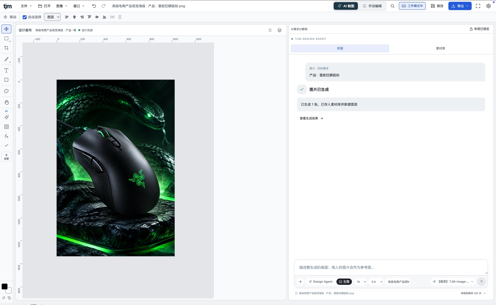
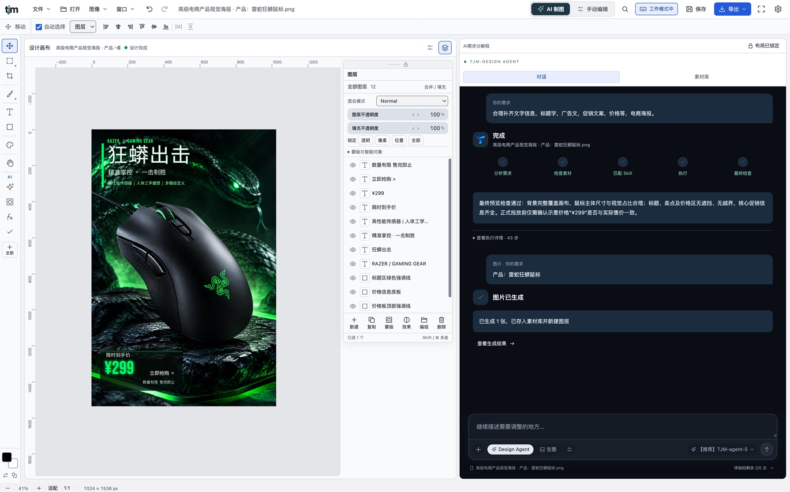
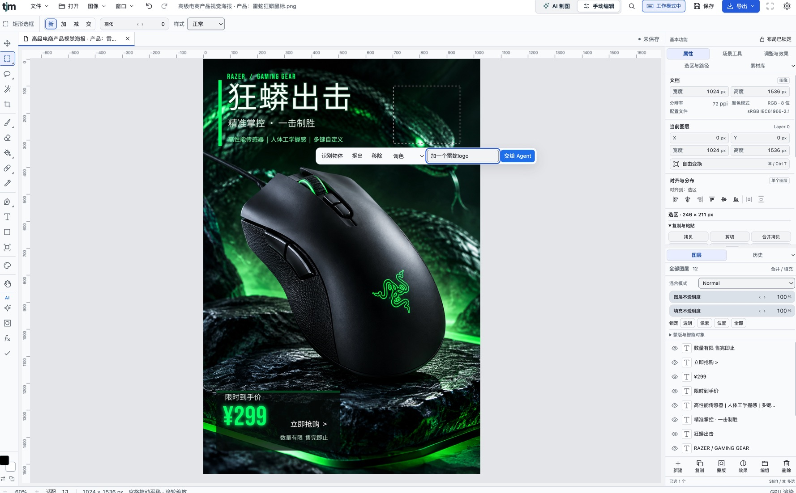
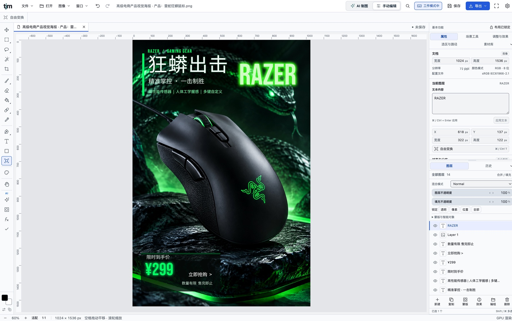
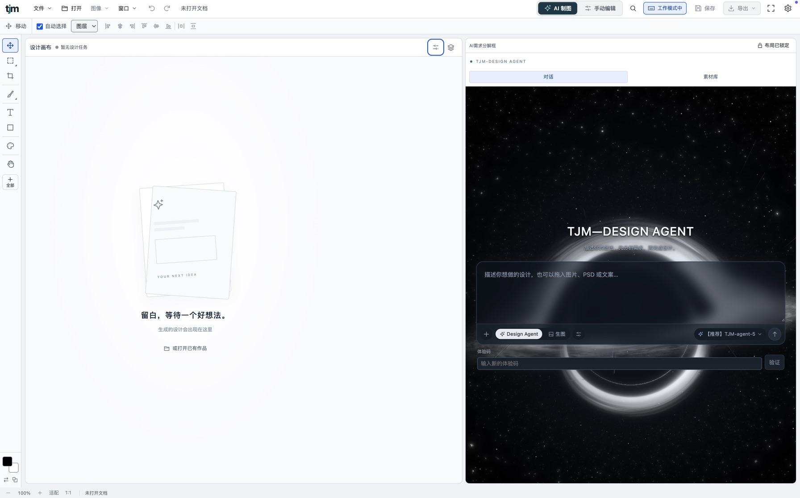
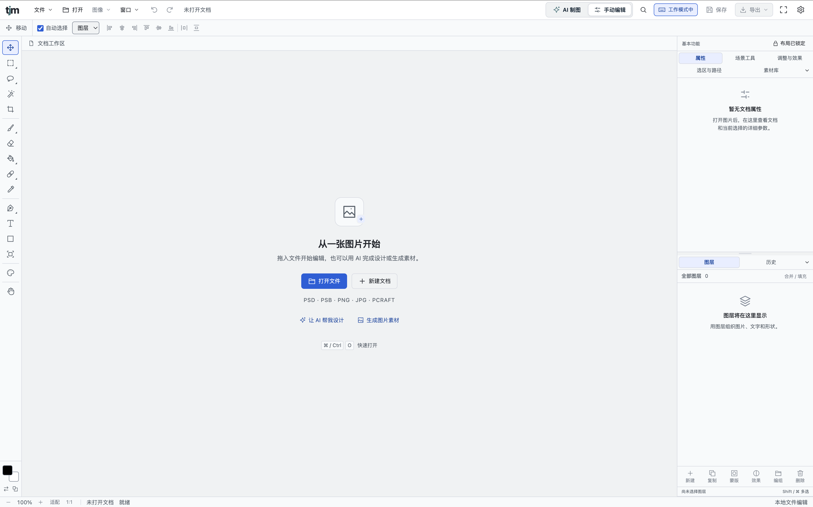
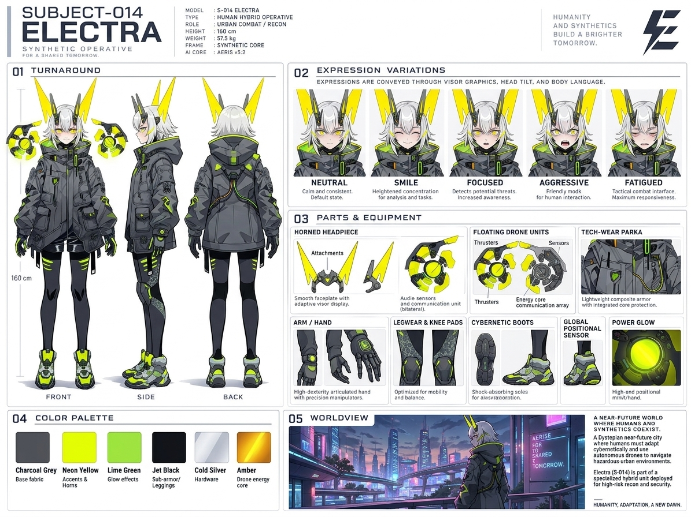
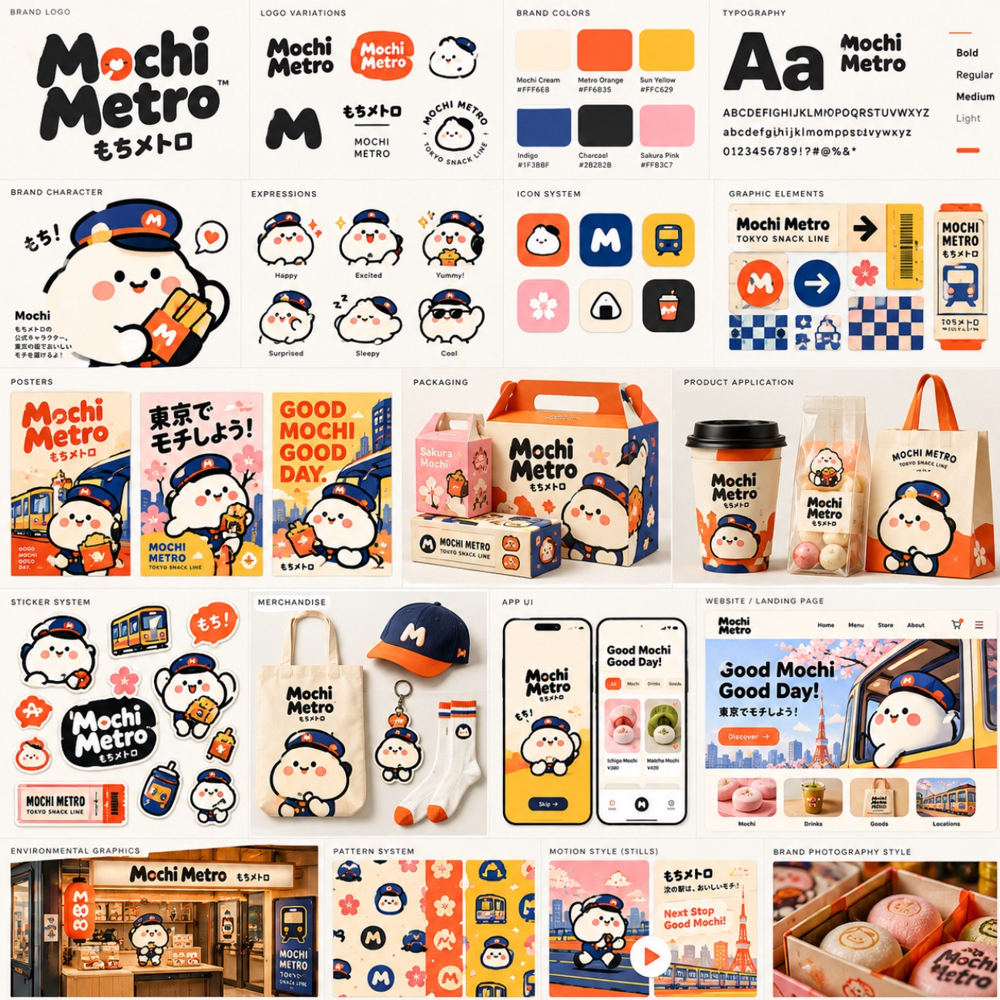

<div align="center">


# TJM Design Studio

**A Photoshop-style layered editor in your browser — with a design agent that actually uses the tools.**

English · [简体中文](README.zh-CN.md) · [日本語](README.ja.md)

[](LICENSE)
-4285F4)


[](#-contributing)

[Live demo](#-live-demo) · [Features](#-features) · [Quick start](#-quick-start) · [AI setup](#-ai-bring-your-own-key) · [License](#-license--copyright)

</div>

---

## ✨ Why

Most AI design tools hand you a flat picture. TJM Design Studio works the other way round. You describe what you want, and the agent builds it **layer by layer with the same tools you use**: text, shapes, selections, masks, adjustments and layer styles. Every step stays editable and undoable, so you can take over at any point.

No install, no account, no server. Everything runs in your browser tab.

## 🖼 Screenshots & work

**The agent at work (product poster)**

| | |
| :---: | :---: |
| <br><sub>1. Generates the product shot onto the canvas</sub> | <br><sub>2. Adds title, selling points and price through the five-step workflow</sub> |
| <br><sub>3. Select an area and let the agent change only that</sub> | <br><sub>4. Everything stays as editable layers</sub> |

**Editor**

| | |
| :---: | :---: |
|  |  |

**Made with the agent**

| | | |
| :---: | :---: | :---: |
| <br><sub>Character sheet</sub> | <br><sub>Commercial product photo</sub> | <br><sub>Brand identity board</sub> |

## 🚀 Live demo

`https://tianming332.github.io/tjm-design-studio-demo/` (published by GitHub Pages from `main`).

- Add `?mock=1` to the URL to try the whole agent workflow with a built-in simulated model. You don't need a key.
- Use Chrome or Edge 113+. The canvas is composited with WebGPU.

## 🧩 Features

| | |
| --- | --- |
| **Layered editing** | Open and save PSD/PSB, PNG, JPEG, WebP, TIFF and more. Layers, masks, adjustment layers, filters, layer styles, text, shapes, transforms, multiple documents and autosave. |
| **Text effects** | 12 presets (neon, gold, metal, sticker…), warped text and real extruded 3D-style lettering. |
| **Smart selection** | Select subject or focus area, then cut out, remove, recolor or regrade only that region. |
| **Design agent** | Analyse brief → check assets → pick a Skill → act with editor tools → preview and self-check. |
| **AI assets** | Text-to-image and image-to-image. Results go to the asset library, then onto the canvas. |
| **Font library** | 19 commercially usable Chinese, Japanese and Latin fonts, each downloaded the first time it's used. |
| **Touch & stylus** | iPad and phone layouts, fullscreen on first touch, pinch to zoom, two-finger tap to undo; with a pen, the pen draws and fingers move the canvas. Scene tools for touch drawing and touch editing. |

15 built-in skills: poster, scoped revision, generated background, text effects, region edit, layer decomposition, poster layer split, illustration layer split, design critique, layout grammar, colour themes, layered painting, e-commerce main image, 9:16 feed, TJM brand.

## ⚡ Quick start

```bash
git clone https://github.com/tianming332/tjm-design-studio-demo.git
cd tjm-design-studio-demo
npm ci
npm run dev            # http://127.0.0.1:5191
```

```bash
npm test               # unit tests
npm run smoke:demo     # end-to-end in Chrome (simulated model + intercepted vendor APIs)
npm run build          # static site in dist/
```

**Publish your own copy:** in *Settings › Pages*, set *Source* to *GitHub Actions*. Every push to `main` then builds and deploys the site through `.github/workflows/pages.yml`.

## 🔑 AI: bring your own key

There is no backend. The agent's workflow, Skill library and asset library run inside the page (SQLite via sql.js, stored in IndexedDB). The page calls the official APIs directly:

| Provider | Agent | Image generation | Get a key |
| --- | :---: | :---: | --- |
| Google Gemini | ✅ | ✅ | aistudio.google.com |
| OpenAI | ✅ | ✅ (GPT Image) | platform.openai.com |
| Anthropic Claude | ✅ | — | console.anthropic.com |
| Zhipu GLM | ✅ | ✅ (CogView) | open.bigmodel.cn |
| DeepSeek | ✅ (text only) | — | platform.deepseek.com |
| Alibaba Qwen (Bailian) | ✅ | ✅ (qwen-image) | bailian.console.aliyun.com |
| ByteDance Doubao (Ark) | ✅ | ✅ (Seedream, AI layer split) | console.volcengine.com/ark |

> [!NOTE]
> Whether a provider can be called straight from a browser depends on its CORS policy. If **测试** (test) reports a connection error, the browser most likely blocked it; use another provider.

Open **AI 制图 → 配置 AI (自带 Key)**, or press `Ctrl/⌘+F` and search "AI 设置". Then paste a key, pick models and run **能力探测** (capability probe).

> [!IMPORTANT]
> Your keys, documents and assets stay **in this browser only**. This project runs no server, so nothing is sent to one. For a public demo, use a **temporary key with a spending limit**, and clear it when you're done. Don't save keys on shared computers.

## 🗂 Project layout

```
src/                     editor (React + TypeScript)
src/engine/              engine bridge, text effects, selection, layout lint
src/local/               in-browser backend (sql.js + IndexedDB, fetch interceptor)
src/local/backend/       agent workflow, tool catalog, Skills, model adapters
engine/                  Rust → WASM bridge source (PhotoCraft v0.6.0)
public/fonts/            fonts, each with its OFL license
```

Rebuilding the engine is optional, because a compiled build ships in `src/engine/pkg/`. To rebuild, install Rust (wasm32 target) and `wasm-bindgen-cli 0.2.129`, then run `engine/build.sh`.

## 🤝 Contributing

Issues and PRs are welcome. Please run `npm test` and `npm run smoke:demo` before opening a PR. By contributing, you agree that your contribution is licensed under Apache-2.0 (see section 5 of the license).

## 📄 License & copyright

- **Code:** [Apache License 2.0](LICENSE), Copyright 2026 TJM. You may use, modify and distribute it, including commercially. You must keep the license and [NOTICE](NOTICE), and mark files you changed. The license includes a patent grant and comes with **no warranty**.
- **Trademarks:** the TJM name and the logos in `public/brand/` (and the lowercase "tjm" wordmark) are **not** covered by the license (Apache-2.0 §6). Forks and redistributions must replace them and must not suggest endorsement.
- **Third-party code:** PhotoCraft (MIT OR Apache-2.0), vgpu and vgpu-optimized-black-hole, ag-psd, React, zustand and sql.js (MIT). License texts are in [`third_party/`](third_party).
- **Design skill sources:** some built-in skills adapt ideas from MIT / Apache-2.0 projects; see [`third_party/design-skill-sources.md`](third_party/design-skill-sources.md).
- **Fonts:** SIL Open Font License 1.1, with the license in each font folder. You may use them freely in your designs, including commercial work and embedded in exported files. You may not sell the font files on their own, and modified fonts must not reuse the reserved font name.
- **Your work and AI output:** you own what you create. AI-generated content is also subject to the terms of the provider you use (Google, OpenAI, Anthropic, Zhipu, DeepSeek, Alibaba, ByteDance), and API usage is billed to your own account. You are responsible for having the rights to anything you upload or import, including images from third-party websites.

<div align="center"><sub>Made for designers who want AI that edits, not just generates.</sub></div>
